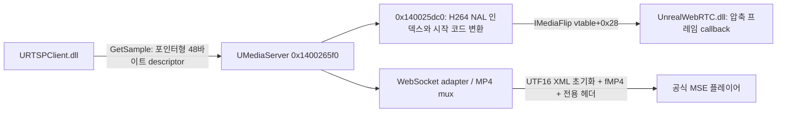

# UMediaServer.exe 네이티브 처리 경로

분석일 2026-10-13. 원본 파일 SHA256
`19fdb1d0888b38a7b5886a57cce774d9ddf0abc7fe02a62ee6e3673ca8b2a1e8`.
REA 6.4.0 + Ghidra 12.1.4의 정적 분석 결과이며 원본 서버 프로세스의 실행 기록은 아니다.
디컴파일 결과는 원본 소스가 아니고, 복원된 함수명 `FUN_*`은 주소 기반 이름이다.
전체 응답과 요청은 `evidence/native/server-v2/`에 있으며 `.c`는 해당 JSON의
`raw_result.value`를 그대로 꺼낸 읽기용 파일이다.

## 연결한 실제 경로

RTSP와 WebRTC DLL 내부의 별도 근거는 `original-rtsp-native.md`,
`original-webrtc-native.md`에 있다. 위 흐름 전체의 서버 실행·부하·오류 동등성을
검증했다는 뜻은 아니다.

## RTSP frame provider 생성과 소비

- `0x140023a60`은 해당 입력 종류에서 `CLSIDFromProgID(L"Unreal.URTSPClient")` 후
  `CoCreateInstance`를 호출한다. 근거 `012-rtsp-create-func`:
  `ev_c079fe4d56af14ba70cdc55ee5cc544266788ea535a2b71b9164c2a64a322e48`.
- 인터페이스 GUID `7c5e98af-e07e-4a9c-b508-c29039cf8ba1`는
  서버 주소 `0x1401544c0`의 16바이트를 실제로 읽어 확인했다(`026-provider-iid`).
- `0x1400265f0`는 provider의 vtable `+0x28`로 샘플을 받는다. 연결 종류 `0xb/0xc`의
  WebRTC 송출 분기에서 H.264 변환 함수를 호출하고 IMediaFlip `+0x28`로 전달한다.
  근거 `039-sink-source`: `ev_fa6e29482ae06bdba06ae20a478140ad41ea593409879fecef88bdb172985850`.
- 샘플은 DLL 사이의 48바이트 포인터형 descriptor와 서버 내부의 inline/refcount buffer를
  구분해야 한다. MSE mux의 내부 샘플에서 길이 `+0x1c`, 데이터 `+0x28`을 읽는 코드를
  DLL ABI의 길이 `+0x20`, 데이터 **포인터** `+0x28`과 혼동하면 안 된다.

## H.264 → WebRTC 변환 (핵심 복원)

함수 `0x140025dc0`, 근거 `040-rtc-normalize`:
`ev_0e04335317c183d431da5c8c1b1ffc55822656229939918d34507ed233d373a8`.

1. 첫 네 바이트가 `00 00 00 01`이면 4바이트 시작 코드 형식으로 분리한다.
2. 그렇지 않으면 4바이트 big-endian 길이로 NAL을 순회한다.
3. 각 NAL의 데이터 시작 offset과 길이를 기록한다. 입력 NAL 인덱스는 최대 60개다.
4. descriptor의 타임스탬프·키프레임 정보 등을 복사하고 데이터 버퍼를 따로 할당한다.
5. keyframe이고 resource의 cached prefix 길이(`+0x5d0`)가 0이 아니면
   `resource+0x4d0`의 바이트를 앞에 붙이고 인덱스 offset을 이동한다. prefix에는
   두 NAL 인덱스를 만든다. H264 경로와 두 항목 구조상 SPS/PPS로 추정되지만,
   이 함수만으로는 cache 생성 경로와 실제 NAL 종류까지 확인한 것이 아니다.
   여기서는 입력 payload에 같은 parameter set이 있는지 중복 검사하지 않는다.
6. AVCC 입력에는 `0x140027e10`을 호출해 길이 접두사를 `00 00 00 01`로 바꾼다.
   NAL 자체의 압축 데이터는 이 함수에서 decode/encode하지 않는다.
7. payload 뒤에 **u32 little-endian 개수, 이어서 u32 offset/u32 length 쌍**을 붙인다.
   descriptor 길이는 trailer를 포함하지 않는다. RTC DLL의 소비 함수와 구조가 일치한다.

길이 변환 보조 함수 근거 `041-avcc-annexb`:
`ev_a820351ac2a86dcb67b81c879fd98ab80241f39193493eb21f524fc927c3d88c`.
이 함수는 읽은 길이가 1이면 즉시 반환한다. 잘못된 길이, 1바이트 NAL과 시작 코드의
모호성, 60개 초과 NAL에 대한 원본의 불완전 처리를 Rust에 그대로 옮기지는 않는다.
안전한 입력 검증으로 달라지는 동작은 이식 코드에서 별도로 명시해야 한다.

## WebRTC 협상과 수명

- URL dispatcher `0x1400673c0`가 `webrtc_playnow/`, `singleport/`, `randomport/`를 해석한다.
- codec 선택 함수 `0x14007a7c0`(`013-codec-gate-func.c`)는
  원본 media type에서 VP8/VP9/H264와 opus/PCMU/PCMA를 선택한다. 지원되지 않는
  codec은 오류 문자열을 반환한다. 여기서 H264 재인코더를 선택하는 동작은 관찰하지 않았다.
- codec 문자열은 `videoCodec + "|-|-|" + audioCodec`로 구성된다.
  `013-codec-gate-func`: `ev_cd87e8ad54ebf3dbbf55828f10499009d3f7564d224a0b59d2c7fdff68accf6e`.
- dispatcher는 PlayingPeerClient CLSID
  `8c5a8556-d17d-4303-b66a-b5f94f3ed9cc`를 생성한다.
  `0x140156d50`의 GUID 값은 DLL typelib과 일치한다(`017-guid-read`).
- `0x140027be0`는 IMediaFlip IID
  `8a607e33-1e5b-47de-a340-82132d8a2f15`로 QueryInterface한다(`024-frame-qi`, `030-sink-iid`).
  dispatcher가 이 interface의 `+0x18`로 media type을 설정하고,
  IPlayingPeerClient `+0x18`에 offer와 protocol 문자열을 넘겨 SDP/candidate BSTR 두 개를 받는다.
- 두 결과를 `|-|-|`로 붙이고 UTF8 text WebSocket 전송 함수 `0x14007a4b0`로 보낸다.
  근거 `010-route-func`: `ev_35c437ebbfafb3a5cdc77c7fc3e801783981448398282bd6d8b11cec1b4c01eb`.
- 종료 처리 함수 `0x140073080`는 종료 표시된 RTC 세션의 IMediaFlip `+0x20`을 호출한다.
  signaling WebSocket과 RTC 수명은 원본 JS에서 확인한 계약에 따라 분리해야 한다.
  소켓 이벤트부터 모든 종료 분기까지의 동등성은 아직 미확인이다.

## MSE: 소비자뿐 아니라 생산자도 확인

RTTI로 `CUnrealWebSocketsAdapter::vftable`를 `0x14015a268`에서 확인했다.
읽은 vtable 포인터와 디컴파일 함수가 다음 계약을 뒷받침한다.

| 함수 | 관찰된 처리 | 근거 |
| --- | --- | --- |
| `0x14009a6c0` | media type 검증, MIME 구성, MP4 mux 초기화. H264 MIME 문자열은 `avc1.42E01E` 상수. 이것만으로 실제 압축 프로파일이 baseline임을 뜻하지 않음 | `014-mse-codec-func`, `ev_94351110da106a733b6d560454274b36ace946abe83e2166d1068b08509472f3` |
| `0x14009bd70` | UTF16 XML `<metadata><mimetypecodec>...` 구성. 서버 명칭에 **12.0.1** 상수가 남아 있음 | `011-mse-init-func`, `ev_08fb6857ae971ad70e755032e109fdb69318233cd54a874959af34cfc24c5604` |
| `0x14009ba60` | WebSocket binary frame, init/error payload 생성. init은 20바이트 헤더, XML byte length at18, XML at20, 그 뒤 초기 MP4 segment | `028-mse-frame`, `ev_42bc933a7827d5fbd6804f8afd06ca01ef2a75c59a8d7a517d973a50cc80fa79` |
| `0x14009abf0` | media payload: byte0=2, byte1=filling, timeshift fields2–5, timestamp i32LE at6, fMP4 at10. time100ns/10000+base로 ms 생성 | `029-mse-setup`, `ev_d885c7e98de82df037906478a0edccd4e0cd16108903b3e95a5179ba1a8dbe7d` |
| `0x14009b160` | WebSocket close/ping 처리 및 `switch:`, `seek:`, `pause`, `continue` 명령 분기 | `027-mse-build`, `ev_3fa80ad9f5b1ed2c944695d38a7a94fdba69c35593a1ec345595d2b01f12d20e` |

init flag는 video-only2 / audio-only1 / both3, realtime이면 왼쪽2bit shift다.
JS에서 해석하던 4/8/12 값이 생산자 코드와 연결되었다. 단일 영상 실시간은8이다.
WebSocket 길이 헤더는 network byte order, **그 안의 언리얼 payload 필드는 little endian**이다.

## MP4 mux: 이식 대상과 남은 범위

- 초기 segment `0x14002bf00`은 두 생성 함수로 ftyp/moov를 serialise한 뒤
  CoTaskMemAlloc 버퍼로 복사한다. `032-mux-initsegment`,
  `ev_05272bb66971b7906c81463dd575fb16a9671d42498f286d07f901fbfc531135`.
- `0x14002c280`의 ftyp major brand는 `isom`, minor version `0x200`이다.
  `042-ftyp`, `ev_c6a36e7a9e704c2996997c8bcc38d0443e32c3ec520420ac735c25dd009a10f6`.
- `0x14002d3f0`는 타임스탬프 차이로 sample duration을 계산하고, keyframe 또는
  지정 fragment duration 조건에서 fragment serialiser를 호출한다.
  `031-mux-fragment`, `ev_ba8c8757a2d9ecba5ba02c1a83fee47171ef9ceec1d6aacd47ac5f0467261892`.
- `0x14002da50`는 `moof`/`traf`와 sample run/track fragment 정보를 생성하고
  데이터를 붙인다(`036-mux-serialize`). RTTI의 AP4 계열 구조와 함께 볼 때
  Bento4 계열 코드를 사용한 것으로 강하게 추정되지만 정확한 upstream 버전은 미확인이다.
- 모든 MP4 box 필드, DTS/PTS/B-frame, audio mux, reconnect/format-change 경계까지
  복원한 것은 아니다. 해당 범위를 검증하기 전에 기존 FFmpeg mux를 원본 이식이라고
  표시하거나 대체 구현의 바이트 동등성을 주장하지 않는다.

## 확인 수준과 한계

원본 서버 함수에서 provider→샘플→H264 normaliser→RTC interface를 연결했고,
MSE는 공식 JS와 서버의 양쪽 헤더 구현을 대조했다. 이는 파일 문자열만 본 조사와 다르다.
다만 원본 **서버 EXE** 실행은 아직 하지 않았다. 별도 RTSP DLL 실행은 해당 보고서에
구분해 기록한다. Ghidra는 거대 dispatcher의 일부 unreachable block/terminal-call
경고를 남겼으며 모든 분기를 완전 복원했다고 주장하지 않는다.
